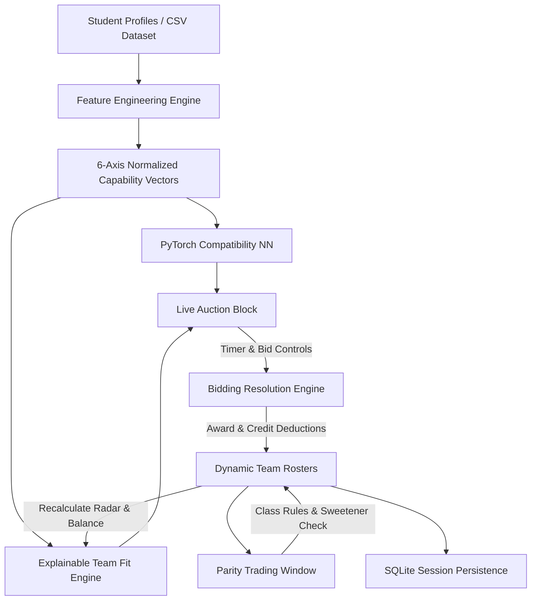

# Pairix 🎯
### Algorithmic Team Formation & Skill-Based Talent Draft Platform

[](https://www.python.org/)
[](https://fastapi.tiangolo.com/)
[](https://react.dev/)
[](https://www.typescriptlang.org/)
[](https://vitejs.dev/)
[](https://pytorch.org/)
[](https://tailwindcss.com/)

> **"Build teams by potential and complementarity, not familiarity."**  
> Pairix replaces subjective, proximity-based student group formation with an algorithmic draft auction and multi-dimensional skill tracking.

---

## 📖 Table of Contents
1. [Problem Statement](#-problem-statement)
2. [Proposed Solution](#-proposed-solution)
3. [Key Features](#-key-features)
4. [6-Axis Capability Radar Formulation](#-6-axis-capability-radar-formulation)
5. [Player Trading & Class Rules](#-player-trading--class-rules)
6. [System Architecture](#-system-architecture)
7. [Quick Start & Installation](#-quick-start--installation)
8. [Project Structure](#-project-structure)
9. [API Documentation](#-api-documentation)

---

## ❗ Problem Statement

In academic settings, hackathons, and capstone engineering courses, student project groups are almost exclusively formed through informal social familiarity or geographic seating. This routinely yields unbalanced teams:
* **The Monoculture Deficit:** One team accumulates three pure backend coders with zero UI/UX, product design, or presentation capabilities.
* **The Ideator Dilemma:** Another team consists of enthusiastic ideators lacking hands-on systems, database, or machine learning expertise.
* **The Free-Rider Dynamic:** Unequal capability distribution creates disproportionate workload burdens and sub-optimal collaborative outcomes.

---

## 💡 Proposed Solution

**Pairix** turns team assembly into a transparent, gamified **Talent Draft & Capability Auction**:
1. **Mathematical Representation:** Student profiles (technical skills, proficiencies, projects, hackathons, certifications, communication, leadership) are modeled into normalized continuous numerical vectors.
2. **6-Axis Hexagonal Capability Radar:** Evaluates individual candidates and aggregate teams across 6 core competency axes.
3. **Dynamic Complementarity Engine:** Calculates explainable **Team Fit Scores** ($0-100\%$) indicating how a candidate fills specific skill deficits, diversifies roles, and enhances overall team balance.
4. **Teacher-Adjudicated Auction Arena:** Franchise teams manage identical virtual credit allocations ($1000\text{c}$) in an ascending-bid draft supervised by an integrated teacher timer.
5. **Parity Trading Round:** A structured post-draft window where franchises can exchange members to address residual bottlenecks under strict institutional class rules.

---

## ✨ Key Features

### 1. 🏛️ Live Auction Room
* **Top Auction Block:** Prominently spotlights the active candidate with their avatar, role, base credit valuation, core skills, and **6-Axis Hexagonal Capability Radar**.
* **Integrated Teacher Timer:** Includes start, pause, resume, and 25-second reset controls with automated state triggers.
* **Auctioneer Desk:** Supports quick credit increments (`+5c`, `+10c`, `+25c`, `+50c`), custom bid inputs, AI counter-bid simulations, passes, and confetti-backed acquisitions (`AWARD / SOLD`).
* **Live Franchise Board:** The 4 competing franchises (*Team Nova*, *Team Orion*, *Team Vertex*, *Team Pulse*) appear cleanly below with remaining credits, roster slots, balance progress bars, and real-time candidate fit predictions.
* **Candidate Queue:** One-click nomination queue to bring waiting candidates to the block.

### 2. 🛡️ 6-Axis Hexagonal Skill Radar
* Custom lightweight SVG visualization rendering sharp regular-hexagonal capability distributions for every player.
* Normalizes candidate depth across 6 fundamental engineering dimensions:
  * **Technical:** Algorithms, C++, Go, data structures, low-level systems.
  * **AI & ML:** PyTorch, Scikit-learn, computer vision (OpenCV/YOLO), NLP, data science.
  * **Development:** Full-stack, React, Node.js, Next.js, WebSockets, REST APIs.
  * **Design & UX:** Figma, Tailwind CSS, design systems, accessibility, motion graphics.
  * **Communication:** Interview scores, presentation benchmarks, team dynamics.
  * **Leadership & Experience:** Agile/Scrum, hackathon wins, chapter leadership, mentorship.

### 3. 🔄 Player Trading Window with Class Rules
* **Tier Categorization:** Players are classified into **Class S** (Elite), **Class A** (Core), and **Class B** (Moderate) based on composite valuation and experience.
* **Parity Constraints:**
  * **Same-Tier Exchanges:** Permitted with zero or minimal credit offset.
  * **Cross-Tier Exchanges:** Acquiring a higher-tier player requires the receiving franchise to compensate the point disparity using virtual credits.
  * **Institutional Parity Veto:** Disparities exceeding 40 credits without compensation are automatically blocked to prevent collusion.
  * **Franchise Anchor Rule:** Team leaders cannot be traded.
* **What-If Simulation:** Previews projected changes in team balance scores before executing any trade.

### 4. 🎮 Iconic Game Character Developer Roster
* Includes 32 distinct candidate profiles inspired by iconic gaming and sci-fi characters (*Geralt Rivia*, *Aloy Sobeck*, *Corvo Attano*, *Aerith Gainsborough*, *Leon Kennedy*, *Kassandra Vex*, *Cloud Strife*, *Samus Aran*, *Gordon Freeman*, *Ezio Auditore*, etc.).
* Zero generic placeholder text or synthetic filler names.

### 5. 📚 Consolidated Field Manual & Guide
* Purely text-based, structured documentation tab explaining draft rules, mathematical formulations, trading constraints, and database storage in one dedicated location.

---

## 📐 6-Axis Capability Radar Formulation

Each candidate vector $\mathbf{v} \in [0, 1]^6$ is calculated from standardized skill tokens and verified achievements:

$$\text{Balance Score} = \left( 1 - \frac{\sigma(\mathbf{r})}{\mu(\mathbf{r}) + \epsilon} \right) \times 100 \times \text{Pen}_{\text{size}}$$

Where:
* $\mathbf{r}$ represents the team's aggregated 6-dimensional radar vector.
* $\sigma(\mathbf{r})$ is the standard deviation across competency axes (penalizing one-sided teams).
* $\mu(\mathbf{r})$ is the mean competency across all 6 axes.
* $\text{Pen}_{\text{size}}$ ensures fair evaluation across roster fill states.

---

## 🔁 Player Trading & Class Rules

```
+-----------------------------------------------------------------+
|                       TRADING PARITY MATRIX                     |
+-------------------+--------------------+------------------------+
| Proposed Exchange | Direct Trade?      | Requirement            |
+-------------------+--------------------+------------------------+
| Class S <-> Class S | Approved (0c)      | Mutual Agreement       |
| Class A <-> Class A | Approved (0c)      | Mutual Agreement       |
| Class B <-> Class B | Approved (0c)      | Mutual Agreement       |
| Class S <-> Class B | Conditionally Veto | Must Compensate Points |
| Net Disparity > 40c| Strictly Vetoed    | Collusion Protection   |
| Team Leader Trade  | Strictly Vetoed    | Franchise Anchor       |
+-------------------+--------------------+------------------------+
```

---

## 🏗️ System Architecture



---

## 🚀 Quick Start & Installation

### Prerequisites
* **Python 3.10+**
* **Node.js 18+ & npm**

### 1. One-Click Launch (Windows)
Clone the repository and run the launch script:
```cmd
git clone https://github.com/Gokulakannan2005/Pairix.git
cd Pairix
run_pairix.bat
```
`run_pairix.bat` automatically:
1. Verifies Python and Node.js.
2. Checks and installs missing Python dependencies from `requirements.txt`.
3. Installs frontend `node_modules` if not already present.
4. Starts the FastAPI backend (`http://127.0.0.1:8000`).
5. Starts the Vite frontend (`http://localhost:5173`).
6. Automatically opens Pairix in your default browser.

To stop the servers at any time, run:
```cmd
stop_pairix.bat
```

---

### 2. Manual Setup (Alternative / macOS / Linux)

#### Backend Setup
```bash
# From repository root
pip install -r requirements.txt
python -m uvicorn backend.main:app --host 127.0.0.1 --port 8000 --reload
```

#### Frontend Setup
```bash
cd frontend
npm install
npm run dev
```
Visit `http://localhost:5173` in your browser.

---

## 📁 Project Structure

```
Pairix/
├── backend/
│   ├── data/
│   │   ├── sample_dataset.py      # 32 unique character developer profiles
│   │   ├── students_sample.csv    # Sample dataset export
│   │   └── pairix.db              # SQLite session & trade database
│   ├── ml/
│   │   ├── balance.py             # Team radar & balance score formulas
│   │   ├── feature_engineering.py # 16-dim and 6-axis vectorization
│   │   ├── model.py               # PyTorch MLP compatibility model
│   │   └── team_fit.py            # Explainable complementarity algorithms
│   ├── models/
│   │   └── schemas.py             # Pydantic models (Student, Team, AuctionState)
│   ├── services/
│   │   ├── auction_manager.py     # Auction state & bidding controller
│   │   ├── database.py            # SQLite ORM & session persistence
│   │   └── trade_manager.py       # Player trading & institutional class rules
│   └── main.py                    # FastAPI application & REST endpoints
├── frontend/
│   ├── src/
│   │   ├── components/
│   │   │   ├── Navbar.tsx         # Streamlined 5-tab navigation
│   │   │   ├── SkillRadarChart.tsx # SVG regular-hexagonal radar component
│   │   │   ├── InitialsAvatar.tsx # Dynamic initial badge avatars
│   │   │   └── StudentProfileModal.tsx # Detailed candidate dossier modal
│   │   ├── pages/
│   │   │   ├── AuctionArenaPage.tsx   # Live auction room & timer controls
│   │   │   ├── TeamDashboardPage.tsx  # Franchise rosters & balance metrics
│   │   │   ├── TradingRoundPage.tsx   # Player exchange with class rules
│   │   │   ├── StudentExplorerPage.tsx# Player catalog with radar cards
│   │   │   └── GuidePage.tsx          # Text-only user manual & tutorial
│   │   ├── services/
│   │   │   └── api.ts                 # Typed REST client
│   │   ├── types/
│   │   │   └── index.ts               # TypeScript data definitions
│   │   ├── App.tsx                    # Root application component
│   │   └── main.tsx                   # React 19 entry point
│   ├── package.json
│   └── vite.config.ts
├── run_pairix.bat                 # Automated Windows launch script
├── stop_pairix.bat                # Safe process shutdown script
├── requirements.txt               # Backend Python dependencies
├── test_acceptance.py             # Automated end-to-end acceptance suite
├── test_new_features.py           # Trade manager & database unit tests
└── README.md                      # Project documentation
```

---

## 🔌 API Documentation

| Endpoint | Method | Description |
|:---|:---:|:---|
| `/api/auction/state` | `GET` | Returns live draft state, candidate on block, and teams |
| `/api/auction/fits` | `GET` | Computes ML team fit scores for candidate on the block |
| `/api/auction/bid` | `POST` | Places a bid on behalf of a franchise |
| `/api/auction/simulate-competing-bid` | `POST` | Simulates an intelligent AI counter-bid |
| `/api/auction/sold` | `POST` | Awards candidate to highest bidder & deducts credits |
| `/api/auction/pass` | `POST` | Passes candidate to deferred pool |
| `/api/auction/nominate/{id}` | `POST` | Nominates a student to the auction block |
| `/api/auction/reset` | `POST` | Restores pristine baseline demo state |
| `/api/trade/evaluate` | `POST` | Evaluates proposed trade against class parity rules |
| `/api/trade/execute` | `POST` | Executes approved player trade and updates rosters |
| `/api/trade/history` | `GET` | Retrieves recorded trade audit history |
| `/api/students` | `GET` | Retrieves candidate catalog with search and filters |
| `/api/teams` | `GET` | Retrieves franchise rosters and balance analytics |

Interactive OpenAPI documentation is available at `http://127.0.0.1:8000/docs` while the backend is running.

---

## 🧪 Verification & Acceptance Tests

Pairix includes comprehensive automated test suites:
```bash
# Acceptance Test (Requires running backend)
python test_acceptance.py

# New Features & Trade Manager Unit Test
python test_new_features.py
```

---

## 📄 License
This project is developed for educational and academic hackathon team formation research. Distributed under the MIT License.
